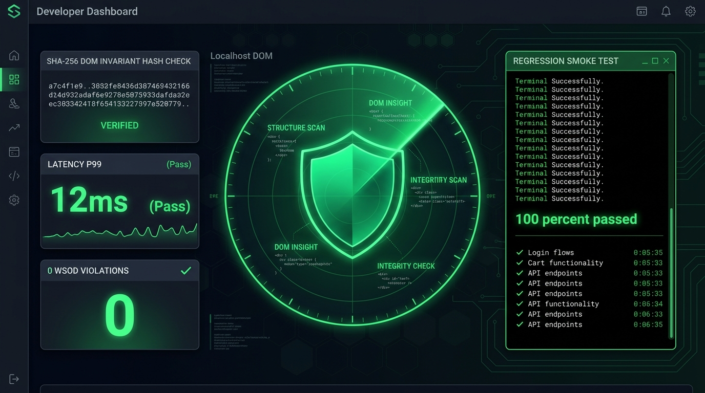

<div align="center">

# ⚡ VisualSmoke

### Zero-Code Localhost Visual Smoke Testing & DOM Invariant Regression Guard
**Catch broken layouts, White Screens of Death (WSOD), latency spikes, and structural DOM drift before committing.**

<br />



<br />

[](https://github.com/SECRET4422/visual-smoke/actions)
[](https://npmjs.com/package/@ssgk4422/visual-smoke)
[](https://opensource.org/licenses/MIT)
[](http://makeapullrequest.com)

[**Quickstart**](#-quickstart) •
[**Interactive HUD**](#-visual-smoke-hud) •
[**DOM Invariants**](#-automated-dom-invariants) •
[**CI/CD Pipeline**](#-headless-cicd-mode) •
[**AlphaTech Studio**](https://alphatech.studio)

</div>

---

## ⚡ The Problem

When running local dev servers (`localhost:3000`, `localhost:5173`, etc.) while building or refactoring with AI:
- ❌ **Silent DOM Breakages:** A rogue component change deletes your submit button or inputs, and you don't notice until users complain.
- ❌ **White Screen of Death (WSOD):** A missing script or runtime crash leaves an empty `<body>` tag while HTTP status remains 200.
- ❌ **Heavy Testing Framework Fatigue:** Setting up Playwright, Cypress, or Selenium requires dozens of config files, browser driver downloads, and minutes of setup time.

## 🛰️ The Solution: VisualSmoke

**`VisualSmoke`** is a zero-configuration CLI and local telemetry dashboard that guards your `localhost`. Point it at any port, and VisualSmoke:
1. **Validates Structural DOM Invariants:** Tracks counts of buttons, inputs, forms, headings, and images.
2. **Computes Structural SHA-256 Layout Hash:** Detects structural drift even when dynamic timestamps change.
3. **P99 Latency Guard:** Alerts on slow responses or frozen event loops (>500ms warning, >1500ms critical).
4. **Instant CI Exit Codes:** Add `visual-smoke --ci` into your pre-push hook or GitHub Actions to instantly fail builds if visual regressions occur.

```
┌────────────────────────────────────────────────────────────────────────┐
│                        VisualSmoke HUD (:4040)                         │
│                                                                        │
│   ┌───────────────────────────┐      ┌───────────────────────────┐     │
│   │ Localhost Scan Ingestion  │      │ Live Render Viewport      │     │
│   │ (:3000, :5173, :8080)     │      │ (Desktop / Mobile Frames) │     │
│   └────────────┬──────────────┘      └───────────▲───────────────┘     │
│                │                                 │                   │
│                ▼                                 │                   │
│   ┌───────────────────────────┐                  │                   │
│   │ DOM Invariant Validator   ├──────────────────┘                   │
│   │ (WSOD, Meta, Layout Hash) │      Interactive Inspection HUD        │
│   └────────────┬──────────────┘                                        │
│                ▼                                                       │
│   ┌────────────────────────────────────────────────────────────────┐   │
│   │ Regression Diff: Element Deltas | Baseline Drift | Pass/Fail   │   │
│   └────────────────────────────────────────────────────────────────┘   │
└────────────────────────────────────────────────────────────────────────┘
```

---

## ⚡ Quickstart

Launch the interactive Visual Smoke studio with zero setup:

```bash
# Launch VisualSmoke studio (auto-opens to http://localhost:4040)
npx @ssgk4422/visual-smoke
```

Or test a specific local server directly:

```bash
npx @ssgk4422/visual-smoke http://localhost:3000
```

Scan multiple ports concurrently:

```bash
npx @ssgk4422/visual-smoke http://localhost:3000,http://localhost:5173
```

---

## 🤖 Headless CI/CD Mode

Integrate into pre-commit git hooks or GitHub Actions workflows with the `--ci` flag:

```bash
npx @ssgk4422/visual-smoke http://localhost:3000 --ci
```

**Terminal Output:**
```
  ⚡ VisualSmoke CI Runner: Inspecting 1 endpoint(s)...

  ✓ [200 OK] http://localhost:3000 (14ms)
    DOM Hash: e3b0c44298fc1c14 | Buttons: 5 | Inputs: 3

  🟢 VisualSmoke CI Verdict: PASSED (All visual and DOM invariants verified)
```

Returns **exit code `0`** on pass, or **exit code `1`** on critical invariant failures.

---

## 🛡️ Automated DOM Invariants

| Code | Invariant Guard | Severity |
| :--- | :--- | :--- |
| `WHITE_SCREEN_OF_DEATH` | Detects empty document bodies or crash screens | 🔴 Critical |
| `HTTP_5XX_SERVER_FAULT` | Intercepts internal server crashes | 🔴 Critical |
| `LATENCY_DEGRADATION_P99` | Flags responses taking longer than 1500ms | 🔴 Critical |
| `STRUCTURAL_DOM_DRIFT` | Alerts when layout SHA-256 hash diverges from baseline | ⚠️ Warning |
| `MISSING_VIEWPORT_META` | Flags pages missing mobile-responsive viewport meta tags | ⚠️ Warning |
| `MISSING_DOCUMENT_TITLE`| Detects missing `<title>` tags | ⚠️ Warning |

---

## 🧪 Built-in Simulation Demos

VisualSmoke includes embedded demo environments so you can test capabilities immediately:
- `http://localhost:4040/demo/clean` — Fast 14ms endpoint satisfying all invariants.
- `http://localhost:4040/demo/degraded` — Simulates missing meta tags, latency delay, and layout shifts.

---

## 🧪 Testing & Quality Gate

```bash
# Clone repo
git clone https://github.com/SECRET4422/visual-smoke.git
cd visual-smoke

# Install & compile
npm install
npm run build

# Run test suite
npm test
```

---

## 🏛️ Engineered by AlphaTech Studio

Built by **Prabhakar Pal** ([@SECRET4422](https://github.com/SECRET4422)) at [**AlphaTech Studio**](https://alphatech.studio).

Complements our open-source developer tooling suite:
- [`agent-cockpit`](https://github.com/SECRET4422/agent-cockpit) — Real-time telemetry HUD & circuit breaker for autonomous AI agents.
- [`vision-craft`](https://github.com/SECRET4422/vision-craft) — Screenshot-to-Fullstack live sandbox with 1:1 ghost diffs.
- [`loopbreaker`](https://github.com/SECRET4422/loopbreaker) — Autonomous AI bug-loop interrupter & circuit breaker.

---

## 📄 License

MIT © [Prabhakar Pal](https://github.com/SECRET4422) · [AlphaTech Studio](https://alphatech.studio)
